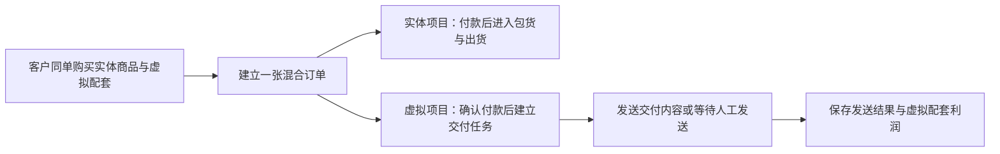

# 虚拟交付菜单实施方案

## 已确认的业务边界

商品管理保留给实体商品与赠品，继续负责规格、库存、进货、包货和商城商品照片。会员、课程和资料包改由独立的 **虚拟交付** 菜单管理；它们可以在商城出售，也可以与实体商品同一订单结账，但不进入库存、进货或包货流程。

## 菜单与页面

| 页面 | 作用 |
|---|---|
| 虚拟交付商品 | 新增和编辑会员、课程、资料包；设置商城显示、是否允许混合结账、通知内容。 |
| 配套／规格 | 为同一虚拟商品设置基础包、进阶包、完整包等；每个配套有独立售价、特价、交付链接、通知内容和成本。 |
| 交付任务 | 显示已付款订单的待发送、已发送、发送失败和人工完成项目；可按会员、课程、资料包筛选。 |
| 利润报表 | 按虚拟商品及配套汇总成交额、优惠、成本、净收入和利润。 |

## 建议的数据结构

| 记录 | 关键内容 | 目的 |
|---|---|---|
| 虚拟商品 | 名称、类型（会员／课程／资料包）、商城显示、混合结账、默认通知内容 | 将日常操作从实体商品管理中分离。 |
| 虚拟商品配套 | 名称、售价、特价、内容成本、交付链接、通知内容 | 支持同一课程或资料包的不同配套。 |
| 订单项目快照 | 购买时的商品名称、配套、成交价、链接、通知内容和成本 | 后续修改商品或链接，不影响已下单客户。 |
| 交付任务 | 订单、客户、订单项目、待发送／已发送／失败／人工完成、发送时间和操作者 | 每一个虚拟订单项目都有独立、可追溯的交付状态。 |
| 发送记录 | 渠道、内容快照、结果、错误、重发次数 | 防止重复发送，并让员工可追查失败原因。 |

## 混合订单流程

本地订单确认付款时，系统仅为订单中实际购买的虚拟配套建立交付任务。任务以订单项目为唯一依据，重复确认付款不会重复建立或重复发送。实体商品的包货状态与虚拟交付状态分别追踪，但都可从同一订单号进入查看。

## 利润规则

虚拟商品不使用进货库存成本。每个配套维护 **内容成本**，例如讲师分成、授权费、制作成本或平台费。订单成立时会保存成本快照。

| 指标 | 计算方式 |
|---|---|
| 配套成交额 | 该配套实际成交价 × 数量 |
| 配套净收入 | 配套成交额 − 分摊到该配套的商品折扣与优惠 |
| 配套利润 | 配套净收入 − 内容成本快照 |

运费只归属于实体项目，不计入虚拟商品利润。订单级折扣会按每个商品项目的成交额比例分摊，确保混合订单中的课程、会员和实体商品利润都能独立核对。

## 不使用 Flow 的通知边界

商品直接管理链接和通知内容后，**不需要 Flow 模板作为业务规则来源**。不过，自动把内容送到客户手上仍需要一个已连接的通知渠道，例如 Messenger、WhatsApp 或电子邮件。

| 阶段 | 交付方式 | 是否需要外部通知渠道 |
|---|---|---|
| 第一阶段 | 付款后自动建立交付任务，员工在任务中复制或手动发送内容，并记录完成 | 否 |
| 第二阶段 | 系统从交付任务自动向客户发送商品快照内容，并记录成功或失败 | 是 |

因此，可以停止使用 Flow 作为会员专用流程；但若要实现无人值守的“自动发送给客户”，仍需在未来启用一个消息渠道。没有外部消息渠道时，系统能准确建立待发送任务和内容快照，但不能自行把文字推送到客户手机。

## 旧功能处理

现有会员订单和 Flow 设置先保留为历史资料，不删除、不覆盖。新虚拟交付菜单稳定后，旧入口可以由管理员选择隐藏或停用；历史会员审核与发送记录仍保留查看。

## 当前实施验收记录

2026-08-19 已在真实登录后台打开 `/virtual-delivery`：独立一级菜单、商品与配套页签、交付任务页签、零资料空状态及“新增虚拟商品”入口均正常加载；当前数据库尚无虚拟交付商品或任务。侧边栏中的旧“会员订单”入口仍保留，待新菜单完成真实业务验收后再隐藏，以保留历史查阅路径。

## 待确认事项

1. 第一阶段是否先采用“自动建立任务＋员工一键复制／手动发送”，暂不连接 Messenger、WhatsApp 或电子邮件自动通知。
2. 是否接受订单级优惠按各项目成交额比例分摊到实体商品和虚拟配套利润。
3. 旧会员订单和 Flow 设置是否在新菜单稳定后隐藏，但继续保留历史查阅能力。
